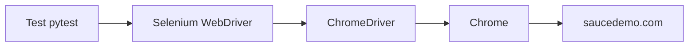

# Bài 0: Giới thiệu cấu trúc dự án & cách chạy dự án

## 1. Mục tiêu
- Hiểu vai trò từng thư mục/file trong dự án.
- Tự dựng môi trường: virtualenv, cài `selenium`, kiểm tra Chrome.
- Chạy được test đầu tiên trên [Swag Labs](https://www.saucedemo.com/) và xem report.

## 2. Lý thuyết (~30%)

### 2.1 Stack sử dụng
| Công cụ | Vai trò |
|---|---|
| Python 3.10+ | Ngôn ngữ |
| Selenium WebDriver | Điều khiển trình duyệt Chrome |
| pytest | Chạy test, assert, fixture, marker |
| pytest-html | Xuất report HTML |

Selenium 4.6+ có **Selenium Manager**: tự tải ChromeDriver phù hợp với Chrome đã cài, không cần tải driver thủ công.

### 2.2 Cây thư mục
```
testing-lab/
├── tests/               # Các file test (test_*.py)
├── pages/               # Page Object (dùng từ bài Page Object)
├── utils/               # Hàm tiện ích dùng chung
├── data/                # Dữ liệu test (user, sản phẩm...)
├── lessons/             # Tài liệu bài học
├── reports/             # Report sinh ra khi chạy (tự tạo)
├── conftest.py          # Fixture dùng chung (driver)
├── pytest.ini           # Cấu hình pytest, marker, report
└── requirements.txt     # Danh sách thư viện
```

### 2.3 Cách Selenium hoạt động


### 2.4 Fixture `driver`
Trong [conftest.py](../conftest.py): mở Chrome → `yield` cho test dùng → `driver.quit()` khi test xong. Test chỉ cần khai báo tham số `driver`.

### 2.5 Cấu trúc một test: Arrange – Act – Assert
```
Arrange (chuẩn bị)  →  Act (thao tác)  →  Assert (kiểm tra)
mở trang login         nhập user, click    URL = /inventory.html
```

### 2.6 Quy tắc chờ
Dùng **explicit wait** (`WebDriverWait` + `expected_conditions`). Không dùng `time.sleep`, không trộn với `implicitly_wait`.

## 3. Example: chạy test đầu tiên

File [test_bai00_smoke.py](../tests/test_bai00_smoke.py): mở Swag Labs, chờ nút Login hiển thị, kiểm tra title.

```python
wait = WebDriverWait(driver, 10)
login_button = wait.until(
    EC.visibility_of_element_located((By.CSS_SELECTOR, "[data-test='login-button']"))
)
assert driver.title == "Swag Labs"
```

### Bước 1 – Kiểm tra Python và Chrome (PowerShell)
```powershell
python --version                     # cần >= 3.10
(Get-Item "C:\Program Files\Google\Chrome\Application\chrome.exe").VersionInfo.ProductVersion
```
Nếu chưa có Chrome, tải tại https://www.google.com/chrome/.

### Bước 2 – Tạo virtualenv
```powershell
python -m venv .venv
.\.venv\Scripts\Activate.ps1
```
### Bước 3 – Cài dependencies
```powershell
pip install -r requirements.txt
```
Kiểm tra: `pip show selenium`.

### Bước 4 – Chạy test
```powershell
pytest                                # chạy tất cả
pytest tests/test_bai00_smoke.py      # chạy 1 file
pytest -m smoke                       # chạy theo marker
pytest --headless                     # chạy không hiện cửa sổ
pytest --html=reports/my.html         # đổi tên report
```
Report mặc định: `reports/report.html`. Kết quả mong đợi: `1 passed`.

## 4. Bài tập tự làm

**Bài 0.1** – Dựng môi trường và chạy thành công `pytest -m smoke`.
- Hoàn thành: thấy `1 passed`, có `reports/report.html`.
- Gợi ý: activate venv trước khi `pip install`.

**Bài 0.2** – Chạy `pytest --headless` và so sánh với chạy thường. Ghi lại 2 điểm khác nhau.

**Bài 0.3** – Sửa title mong đợi thành `"Swag Lab"`, chạy lại, đọc thông báo lỗi. Dòng nào cho biết giá trị expected và actual? Sau đó sửa lại như cũ.

**Bài 0.4** – Thêm test thứ hai (marker `smoke`): kiểm tra ô `username` và `password` đều hiển thị.
- Gợi ý: `[data-test='username']`, `[data-test='password']`, `visibility_of_element_located`.

**Bài 0.5** – Chạy `pytest --collect-only` và giải thích output cho biết điều gì.

**Bài 0.6 (nâng cao)** – Thêm option `--base-url` vào `conftest.py` để đổi URL khi chạy.
- Gợi ý: `parser.addoption` trong `pytest_addoption`.

## 5. Checklist hoàn thành
- [ ] Kiểm tra được phiên bản Python và Chrome
- [ ] Tạo và activate được virtualenv, cài được `selenium`
- [ ] Chạy được 1 file, chạy theo marker, chạy `--headless`
- [ ] Mở được `reports/report.html`
- [ ] Đọc hiểu được 1 thông báo test fail
