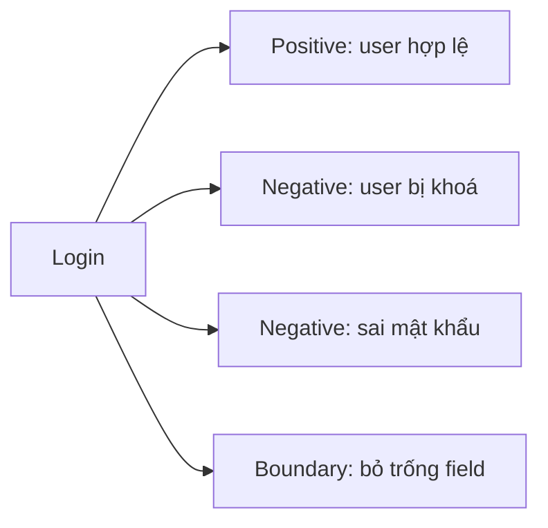

# Bài 1: Test chức năng Login cơ bản

## 1. Mục tiêu
- Tìm phần tử bằng `By.CSS_SELECTOR` và thao tác (`send_keys`, `click`).
- Dùng explicit wait đúng cách.
- Viết assertion bằng `assert` với thông báo lỗi rõ nghĩa.
- Thiết kế test case login: positive & negative.
- Dùng `@pytest.mark.parametrize` để tránh lặp code.

## 2. Lý thuyết (~30%)

### 2.1 Locator trên Swag Labs
Site có thuộc tính `data-test` ổn định, nên ưu tiên dùng:

| Phần tử | Locator |
|---|---|
| Username | `[data-test='username']` |
| Password | `[data-test='password']` |
| Nút Login | `[data-test='login-button']` |
| Thông báo lỗi | `[data-test='error']` |

Thứ tự ưu tiên: `By.CSS_SELECTOR` với `data-test` / `By.ID` → CSS khác → XPath (hạn chế).

### 2.2 Thao tác và tìm phần tử
```python
el = driver.find_element(By.CSS_SELECTOR, "[data-test='username']")  # 1 phần tử, lỗi nếu không thấy
els = driver.find_elements(By.CSS_SELECTOR, "[data-test='inventory-item']")  # list, rỗng nếu không thấy
el.send_keys("text"); el.click(); el.clear(); el.text
```

### 2.3 Explicit wait
```python
wait = WebDriverWait(driver, 10)
wait.until(EC.visibility_of_element_located((By.CSS_SELECTOR, "[data-test='error']")))
wait.until(EC.url_to_be("https://www.saucedemo.com/inventory.html"))
```
Chờ điều kiện cụ thể thay vì chờ cố định; không dùng `time.sleep`.

### 2.4 Tài khoản test (password chung: `secret_sauce`)
| User | Hành vi mong đợi |
|---|---|
| standard_user | Login thành công |
| locked_out_user | Bị chặn, báo lỗi "locked out" |
| problem_user | Login được, UI có lỗi (dùng ở bài sau) |
| performance_glitch_user | Login được nhưng chậm |
| visual_user | Login được, có lỗi giao diện |

### 2.5 Thiết kế test case login

Mỗi test chỉ kiểm tra **một mục đích**, tên test mô tả rõ hành vi.

### 2.6 Assertion
```python
assert title.text == "Products", f"Tiêu đề sai: {title.text!r}"
assert len(items) == 6, f"Mong đợi 6 sản phẩm, thực tế {len(items)}"
```

## 3. Example: login thành công với standard_user

Code trong [test_bai01_login.py](../tests/test_bai01_login.py):
```python
@pytest.mark.login
def test_login_thanh_cong_standard_user(login_page):
    driver = login_page
    wait = WebDriverWait(driver, 10)

    driver.find_element(By.CSS_SELECTOR, "[data-test='username']").send_keys("standard_user")
    driver.find_element(By.CSS_SELECTOR, "[data-test='password']").send_keys("secret_sauce")
    driver.find_element(By.CSS_SELECTOR, "[data-test='login-button']").click()

    wait.until(EC.url_to_be("https://www.saucedemo.com/inventory.html"))
    title = wait.until(
        EC.visibility_of_element_located((By.CSS_SELECTOR, "[data-test='title']"))
    )
    items = driver.find_elements(By.CSS_SELECTOR, "[data-test='inventory-item']")

    assert title.text == "Products", f"Tiêu đề sai: {title.text!r}"
    assert len(items) == 6, f"Mong đợi 6 sản phẩm, thực tế {len(items)}"
```
Giải thích:
1. Fixture `login_page` (trong `conftest.py`) mở sẵn trang login → *Arrange*.
2. `send_keys` + `click` → *Act*.
3. `wait.until(url_to_be)` chờ chuyển trang, rồi `assert` kiểm tra tiêu đề và 6 sản phẩm → *Assert*.

Chạy: `pytest -m login`

## 4. Bài tập tự làm
Viết trong `tests/test_bai01_login.py`, dựa theo example.

**Bài 1.1 – locked_out_user (dễ)**
- Yêu cầu: login bằng `locked_out_user` / `secret_sauce`.
- Hoàn thành: vẫn ở trang login; lỗi hiển thị và chứa "locked out".
- Gợi ý: `[data-test='error']`, kiểm tra bằng `in`.

**Bài 1.2 – Sai mật khẩu (dễ)**
- Yêu cầu: `standard_user` + mật khẩu sai.
- Hoàn thành: lỗi báo username và password không khớp; URL không đổi.

**Bài 1.3 – Bỏ trống username (dễ)**
- Hoàn thành: lỗi "Username is required".

**Bài 1.4 – Bỏ trống password (trung bình)**
- Hoàn thành: lỗi "Password is required". Lưu ý: cần nhập username trước.

**Bài 1.5 – Parametrize (trung bình)**
- Yêu cầu: một test duy nhất chạy cho `standard_user`, `problem_user`, `performance_glitch_user`, `visual_user` đều login thành công.
- Hoàn thành: pytest báo 4 test case riêng; code không lặp.
- Gợi ý: `@pytest.mark.parametrize("username", [...])`; với `performance_glitch_user` hãy tăng timeout của wait.

**Bài 1.6 – Logout (nâng cao)**
- Yêu cầu: login rồi logout qua menu burger → về trang login.
- Hoàn thành: URL là `https://www.saucedemo.com/`; ô username rỗng.
- Gợi ý: `#react-burger-menu-btn`, `[data-test='logout-sidebar-link']`; chờ menu mở bằng `element_to_be_clickable`.

**Bài 1.7 – Vào trang sản phẩm khi chưa login (nâng cao)**
- Yêu cầu: `driver.get(".../inventory.html")` không login.
- Hoàn thành: bị chặn, có thông báo lỗi. Tự quan sát để viết expected result.

## 5. Checklist hoàn thành
- [ ] Hiểu và chạy được example
- [ ] Hoàn thành tối thiểu bài 1.1–1.4 (đều pass)
- [ ] Dùng được `parametrize` (bài 1.5)
- [ ] Không dùng `time.sleep` và `implicitly_wait`
- [ ] Locator dùng `data-test`/ID, hạn chế XPath
- [ ] Mỗi test có tên rõ nghĩa và đúng 1 mục đích
- [ ] `pytest -m login` pass toàn bộ, xem được report
